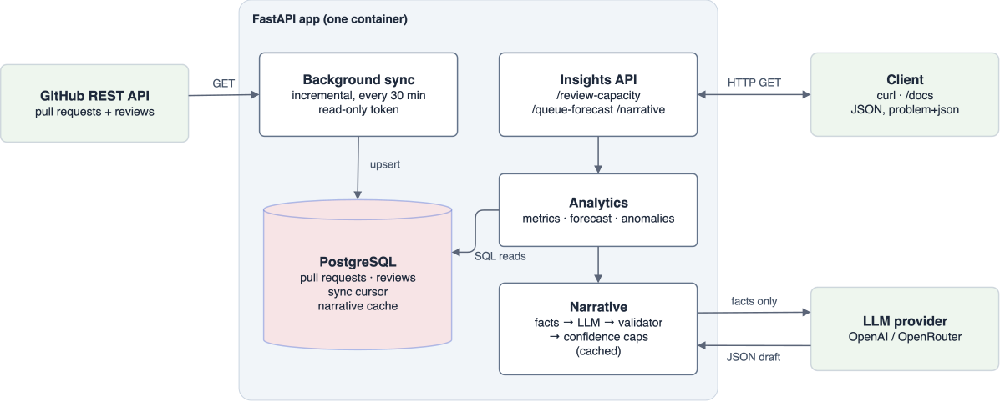

# Review Capacity Radar

This project treats code review as a queue. It syncs a GitHub repository's pull requests and reviews, measures and forecasts whether review keeps up with incoming work, and has an LLM explain the result using only numbers that code computed and checked.

<p align="center">
    
</p>

- **Integrates** the GitHub REST API: a background sync copies pull requests and reviews
  into Postgres, incrementally.
- **Insights over a period:** arrivals vs reviews, wait times, queue size, a flow-balance
  self-check, Little's Law, reviewer concentration and unusual weeks.
- **Forecast:** a Monte Carlo simulation of the queue for the coming weeks.
- **Narrative:** an LLM writes a root-cause hypothesis with a confidence score and an
  evidence chain. Every number it writes is checked against the fact it cites.

Design, trade-offs and next steps are in [NOTES.md](NOTES.md).

## Quickstart (Docker)

You need Docker, a GitHub token and an OpenAI API key.

```bash
git clone https://github.com/upul/review-capacity-radar && cd review-capacity-radar
cp .env.example .env            # See the Configuration section below
docker compose up --build -d
docker compose logs -f app      # wait for "synced scikit-learn/scikit-learn"
```

The first sync fetches 12 weeks of history and takes a few minutes; until it finishes, the
insight endpoints answer `404 … has not been synced yet`. After that, the app re-syncs
every 30 minutes, which takes seconds.

```bash
curl -s localhost:8000/health
curl -s localhost:8000/api/v1/repos/scikit-learn/scikit-learn/insights/review-capacity | jq .flow_balance
curl -s localhost:8000/api/v1/repos/scikit-learn/scikit-learn/insights/queue-forecast | jq .forecast
curl -s localhost:8000/api/v1/repos/scikit-learn/scikit-learn/insights/narrative | jq '{source, narrative, evidence}'
```

Interactive API docs: <http://localhost:8000/docs>

**GitHub token:** a fine-grained personal access token with access to public repositories
only and no extra permissions (read-only).

## API

| Endpoint | What it returns |
|---|---|
| `GET /health` | `200 {"status": "ok"}`, or `503` if the database is unreachable |
| `GET /api/v1/repos/{owner}/{repo}/insights/review-capacity?from=&to=` | arrivals, reviews, waits, queue, flow balance, Little's Law, reviewers, weekly series, data quality |
| `GET /api/v1/repos/{owner}/{repo}/insights/queue-forecast?weeks=4` | the queue's p10 / p50 / p90 for each of the next 1 to 12 weeks |
| `GET /api/v1/repos/{owner}/{repo}/insights/narrative?from=&to=` | summary, hypothesis, confidence, the facts it cites, and whether it came from the LLM, the cache or the fallback |

- `from` and `to` are dates (`YYYY-MM-DD`, UTC, both inclusive). By default the window is
  the 12 weeks ending on the last complete day of synced data, at most 182 days.
- Errors are [RFC 7807](https://www.rfc-editor.org/rfc/rfc7807) problem details
  (`application/problem+json`): `400` for a window outside the synced data, `404` for a
  repository that hasn't been synced, `422` for malformed parameters.


## Configuration

Set in `.env` (see [.env.example](.env.example)); secrets are never logged.

| Variable | Default | Meaning |
|---|---|---|
| `DATABASE_URL` | (required) | `postgresql+asyncpg://…`; Compose sets it for the container |
| `GITHUB_TOKEN` | (required) | read-only GitHub token |
| `LLM_API_KEY` | (required) | OpenAI or OpenRouter key |
| `LLM_MODEL` | (required) | e.g. `gpt-4.1-mini`, or `openai/gpt-4.1-mini` on OpenRouter |
| `LLM_BASE_URL` | OpenAI | `https://openrouter.ai/api/v1` for OpenRouter |
| `SYNC_REPOS` | scikit-learn, vLLM | repositories to keep synced, comma-separated |
| `SYNC_ENABLED` | `true` | run the background sync |
| `SYNC_INTERVAL_MINUTES` | `30` | pause between syncs |
| `SYNC_LOOKBACK_WEEKS` | `12` | history fetched by the first sync |
| `LOG_LEVEL` | `INFO` | |
